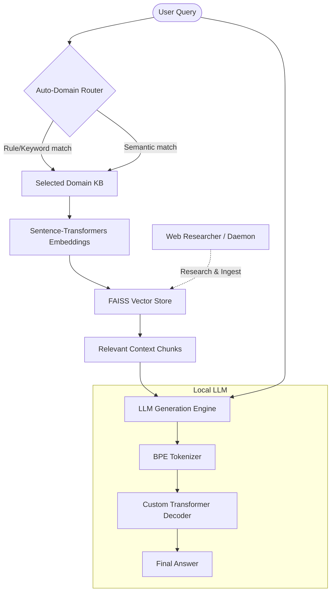

# 🎯 Tiny LLM with Domain-Specific RAG

A lightweight, modular, and highly efficient project combining a custom-trained **Transformer Decoder LLM** with a **Domain-Specific Retrieval-Augmented Generation (RAG)** pipeline. This project demonstrates how small-scale models can punch well above their weight class when paired with a highly structured vector database, web research capabilities, and semantic routing.

---

## 🌟 Why This Project Is Special

Most modern RAG applications rely on massive, general-purpose LLMs (like GPT-4 or Claude) hosted in the cloud. This project takes the opposite approach: **privacy-first, resource-efficient local intelligence**.

- **Hyper-Local & Tiny**: Runs a custom-built, decoder-only Transformer locally on consumer hardware without GPU requirements.
- **Dynamic Semantic Routing**: Instead of querying a single massive database, queries are automatically classified (e.g., Medical, Legal, Survival, Math) and matched to a domain-isolated knowledge base.
- **Continual Web-Scraping / Research**: Features a built-in search and research daemon that automatically crawls the web to patch knowledge gaps, ensuring the local model doesn't suffer from static knowledge cutoffs.
- **Hybrid Inference Engine**: Choose between pure neural generation (`toy_llm`), retrieval-augmented generation (`smart_rag`), or a blended `hybrid` engine.

---

## 🏗️ Architecture



### 🛡️ Core Layers

1. **The LLM (Neural Engine)**:
   - Configurable Decoder-only Transformer model implemented in PyTorch (`src/model.py`).
   - Custom Byte-Pair Encoding (BPE) subword tokenizer (`src/tokenizer.py`) designed for efficient token-to-dimension representation.
   - Support for cosine learning-rate decay, linear warmup, and ONNX exports for runtime acceleration.

2. **The Domain RAG Layer**:
   - Dynamic domain configurations managed in `domains.yaml`.
   - Domain-specific databases isolating knowledge bases (e.g., Medical data, Legal documents) so the model receives highly relevant context without noise.
   - Vector indexing via `faiss` and semantic embeddings via `all-MiniLM-L6-v2`.

3. **Autonomous Researcher**:
   - Web Researcher (`src/web_researcher.py`) that queries sources (Wikipedia, Google search scrapers) to enrich domain knowledge dynamically on request.

---

## 🚀 Features

- 🎯 **Automated Domain Detection**: Dynamically routes user queries to the correct domain context using keyword priority and threshold-based semantic matching.
- 🩺 **Domain Disclaimers**: Automatically appends legally required disclaimers for sensitive domains like `legal` and `medical`.
- 🌐 **Web Research & Ingestion**: Running `/research [topic]` prompts the model to browse, clean, embed, and ingest internet resources on-the-fly.
- 🔌 **FastAPI Server**: Ready-to-use API endpoints in `server.py` for integration with external web apps or mobile bundles.
- ⚡ **ONNX Support**: Export trained models to ONNX formats for lightweight runtime execution on mobile or edge devices.

---

## 📂 Directory Structure

* **`src/`**: The core source code containing the Transformer, Tokenizer, RAG engine, and Web Researcher.
* **`scripts/`**: Convenience scripts for downloading datasets, training pipelines, exporting models, and starting learning daemons.
* **`knowledge_base/`**: Storage directories for raw documents and local vector indexes.
* **`training_data/`**: Raw datasets used to train the base tokenizer and model weights.
* **`config.yaml`**: The single source of truth for hyperparameters, chunk sizes, and system configuration.
* **`domains.yaml`**: Configuration file specifying auto-detect thresholds, rules, and priority levels for each domain.

---

## 🛠️ Getting Started

### 1. Installation
Ensure you have Python 3.10+ installed. Install dependencies using pip:
```bash
pip install -r requirements.txt
```

### 2. Run the Interactive CLI
Start the domain-aware interactive shell:
```bash
python main.py
```
Inside the shell, you can use slash commands:
* `/domains` - List all available domains.
* `/mode [domain_id]` - Manually switch active domains (e.g., `/mode survival`).
* `/auto` - Toggle automatic domain detection on/off.
* `/research [topic]` - Search the web and ingest knowledge about a topic.
* `/engine [smart_rag|toy_llm|hybrid]` - Switch the inference mode.

### 3. Run the API Server
Expose the LLM and RAG pipelines via HTTP endpoints:
```bash
uvicorn server:app --reload
```
