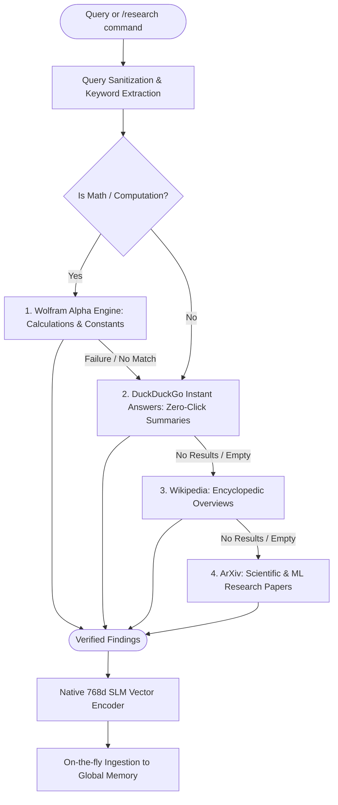

# 🌐 Kruuboo Tiny LLM (SLM-0.2) — Multi-Provider Web Research Guide

Kruuboo-SLM-0.2 features a **multi-provider web research and dynamic learning engine** implemented in `src/web_researcher.py`. When local semantic memory lacks high-confidence evidence ($S < 0.40$), or when triggered by the `/research` command, the system autonomously queries an intelligent fallback chain to retrieve, summarize, and ingest grounded knowledge.

---

## 🏗️ Fallback Provider Architecture

The research engine executes providers sequentially in priority order. If a provider fails or returns zero relevant results, execution seamlessly cascades to the next provider:



---

## 🔍 Provider Details & Capabilities

### 1. Wolfram Alpha (`wolfram`)
- **Primary Use**: Exact mathematical calculations, unit conversions, physics constants, planetary data, and formulas.
- **Routing**: Automatically prioritized when queries contain symbols like `+`, `-`, `*`, `/`, `=`, or keywords like `calculate`, `derivative`, `speed of`, `how far`.
- **API**: Full Result API or Short Answer API with configurable App ID in `config.yaml`.

### 2. DuckDuckGo Instant Answers (`duckduckgo`)
- **Primary Use**: Fast, unauthenticated instant answers, entity definitions, and zero-click web overviews.
- **Privacy**: No tracking or user accounts required.
- **Endpoint**: `https://api.duckduckgo.com/` (extracts `AbstractText` and `RelatedTopics`).

### 3. Wikipedia Encyclopedic Articles (`wikipedia`)
- **Primary Use**: Comprehensive background knowledge on history, medicine, geography, biology, and culture.
- **Features**: Disambiguation error handling, section summarization, and source URL attribution.

### 4. ArXiv Scientific Papers (`arxiv`)
- **Primary Use**: Recent artificial intelligence, physics, mathematics, and computer science preprint literature.
- **Endpoint**: ArXiv Open Access Atom API (`http://export.arxiv.org/api/query`).
- **Data Extracted**: Paper Title, Abstract, and direct arXiv document link.

---

## ⚙️ Configuration in `config.yaml`

The web research engine is configured under the `web_research` block in `config.yaml`:

```yaml
web_research:
  enabled: true
  max_results: 3
  
  # Execution order for fallback cascade
  providers:
    - wolfram        # Math & scientific calculations (if query matches math patterns)
    - duckduckgo     # Fast, unauthenticated instant answers & web summaries
    - wikipedia      # Detailed encyclopedic knowledge & article summaries
    - arxiv          # Academic research papers for science/AI/math queries
  
  duckduckgo:
    enabled: true
    timeout: 5

  wikipedia:
    enabled: true
    language: "en"
    max_results: 3

  wolfram:
    enabled: true
    appid: "YOUR_WOLFRAM_APPID"    # Optional: replace with your Wolfram App ID
    timeout: 5

  arxiv:
    enabled: true
    max_results: 2
    timeout: 5
```

---

## 💻 CLI & Interactive Usage

### 1. Via Conversational Terminal Shell (`main.py`)
```bash
python3 main.py

# In the shell prompt:
You: /research James Webb Space Telescope discoveries
Assistant: 🔍 Researching 'James Webb Space Telescope discoveries' across web providers...
✅ Learned and indexed 3 new knowledge items into global memory.
```

### 2. Direct Programmatic Ingestion via Python
```python
from src.rag import RAGSystem

rag = RAGSystem()

# Research topic and immediately ingest into 768d memory
success = rag.research_and_learn("Quantum Error Correction Surface Codes")

if success:
    print("New research successfully acquired and embedded!")
    
# Query the newly learned knowledge
result = rag.ask("How do surface codes handle quantum errors?")
print(result["answer"])
```

---

## 🧹 Query Sanitization & Noise Reduction

Before dispatching HTTP requests to external APIs, `clean_query()` in `src/web_researcher.py` strips conversational fluff:

- Removes stop phrases: *"what is"*, *"tell me about"*, *"can you explain"*, *"who was"*, *"please search for"*.
- Normalizes punctuation and excessive whitespace.
- Transforms `"can you tell me what is the speed of light?"` $\rightarrow$ `"speed of light"`.

This ensures optimal search relevance across API endpoints.
